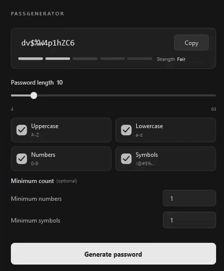

# Password Generator

A simple password generator made with Python and PyQt6.

## Preview



## Features

- Customizable password length
- Uppercase and lowercase letters
- Numbers and symbols
- Minimum number and symbol requirements
- Password strength indicator
- Copy to clipboard
- Dark UI with animations

## Installation

Download the latest version from [Releases](https://github.com/bonjerp/PassGen/releases), or run it from source.

### Running from source

Requires Python 3 and PyQt6.

```bash
git clone https://github.com/bonjerp/PassGen.git
cd PassGen
pip install PyQt6
python main.py
```

## Built With

- Python
- PyQt6
- PyInstaller

## Author

[bonjerp](https://github.com/bonjerp)